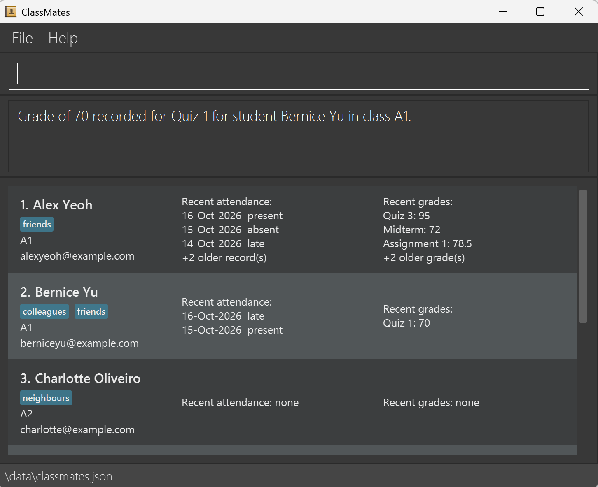
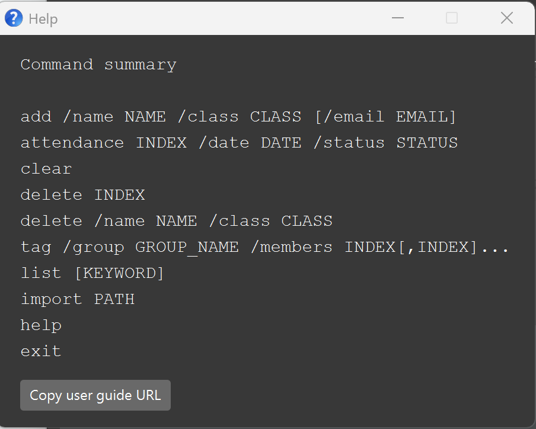

# ClassMates User Guide

ClassMates is a **desktop application for managing contacts, optimized for use through a Command Line Interface (CLI)** while retaining the benefits of a Graphical User Interface (GUI). If you type quickly, ClassMates can help you manage contacts faster than traditional GUI applications.

<!-- * Table of Contents -->
<page-nav-print />

--------------------------------------------------------------------------------------------------------------------

## Quick start

1. Ensure that Java `25` or later is installed on your computer.<br>
   **Mac users:** Ensure you have the precise JDK version prescribed [here](https://se-education.org/guides/tutorials/javaInstallationMac.html).

1. Download the latest `.jar` file from [here](https://github.com/AY2627S1-CS2103-F09-1/tp/releases).

1. Copy the file to the folder you want to use as the _home folder_ for your ClassMates.

1. Open a terminal, `cd` to the folder containing the JAR file, and run `java -jar classmates.jar`.<br>
   A GUI similar to the one below should appear in a few seconds. Note how the app contains some sample data.<br>
   

1. Type a command in the command box and press Enter to execute it. For example, type **`help`** and press Enter to open the help window.<br>
   Some example commands you can try:

   * `list` : Lists all contacts.

   * `list John` : Lists the contacts whose name, class or tags contain `John`.

   * `add /name John Doe /class A1 /email johnd@example.com` : Adds a contact named `John Doe` in class `A1` to ClassMates.

   * `edit 2 /email newmail@example.com` : Changes the email of the 2nd contact shown in the current list to `newmail@example.com`.

   * `delete 3` : Deletes the 3rd contact shown in the current list.

   * `delete /name John Doe /class A1` : Deletes the contact named `John Doe` in class `A1`.

   * `tag /group Group A /members 1,2` : Links the 1st and 2nd contacts shown in the current list to the group `Group A`.

   * `untag /group Group A /members 1` : Removes the 1st contact shown in the current list from the group `Group A`.

   * `attendance 1 /date 14-10-2026 /status present` : Adds attendance record to contact in the 1st index as `present` on `14-10-2026`

   * `attendance /name John Doe /class A1 /date 14-10-2026 /status present` : Adds attendance record to contact named `John Doe` in class `A1` as `present` on `14-10-2026`

   * `viewA /name John Doe /class A1` : Lists the attendance records of `John Doe` in class `A1`

   * `clear` : Deletes all contacts.

   * `exit` : Exits the app.

1. Refer to the [Features](#features) section below for details of each command.

--------------------------------------------------------------------------------------------------------------------

## Features

<box type="info" seamless>

**Notes about the command format:**<br>

* Words in `UPPER_CASE` are the parameters to be supplied by the user.<br>
  For example, in `add /name NAME`, replace `NAME` with a value such as `John Doe`.

* Each parameter is introduced by a prefix that starts with `/`, such as `/name`.<br>
  The prefix must be separated from the value, and from the preceding parameter, by a space.<br>
  For example, `/name John Doe` is valid, but `/nameJohn Doe` is not.<br>
  Prefixes are not case-sensitive. For example, `/NAME John Doe` and `/Name John Doe` are the same as `/name John Doe`.

* Command words are not case-sensitive.<br>
  For example, `list`, `LIST` and `List` are the same command, and `viewA` can also be typed as `viewa` or `VIEWA`.

* Items in square brackets are optional.<br>
  For example, `/name NAME [/email EMAIL]` can be used as `/name John Doe /email johnd@example.com` or as `/name John Doe`.

* Items followed by `...` can appear zero or more times.<br>
  For example, `/members INDEX[,INDEX]...` can be written as `/members 1` or as `/members 1,3,5`.

* Parameters can be in any order.<br>
  For example, if the command specifies `/name NAME /class CLASS`, `/class CLASS /name NAME` is also acceptable.

* Extraneous parameters for commands that take no parameters, such as `help` and `exit`, are ignored.<br>
  For example, `help 123` is interpreted as `help`.<br>
  The exception is `clear`, which does not accept anything after it, because it deletes all contacts. For example, `clear 3` shows an error and does not delete anything.

* A command can have at most 5,000 characters. A longer command shows `The command is too long. It can have at most 5000 characters` and nothing happens.

* If you are using a PDF version of this document, be careful when copying and pasting commands that span multiple lines as space characters surrounding line-breaks may be omitted when copied over to the application.
</box>

### Viewing help: `help`

Opens a window that summarizes the format of every command, with a button to copy the link to this user guide.



Format: `help`

* You can also open the help window from the `Help` menu or by pressing `F1`.
* If the help window is already open, it is brought to the front.


### Adding a contact: `add`

Adds a contact to ClassMates.

Format: `add /name NAME /class CLASS [/email EMAIL]`

* `NAME` cannot be empty and can be at most 80 characters long. It can contain English letters, digits, spaces and the symbols on a standard keyboard, such as `'`, `-`, `.`, `/`, `(`, `)` and `#`, as in `Tan s/o Kumar` or `Peter (Pete) Lim`.
  * Accented letters such as `é`, `ñ` and `ü` are allowed, as in `José Müller` or `Nguyễn Văn An`. Letters of other languages, such as Chinese or Cyrillic letters, are not accepted.
  * Commas are not allowed, because they separate the values in a CSV file.
  * A word that starts with `/` after a space is read as a parameter, so a `/` can be used inside a name, but not at the start of a word.
* `CLASS` must start with a letter or a digit and can be at most 80 characters long. It can only contain the English letters `A-Z` and `a-z`, digits, spaces, and the characters `-`, `.`, `_`, `/`, `(` and `)`, as in `Sec 3-2`, `CS2103_T11`, `T11/A` or `Sec 3 (Morning)`.
* A name or class cannot contain a parameter name that is stuck to the text before it, such as `John/class A1`, as this is most likely a missing space. The parameter names that are checked are `/name`, `/class`, `/email`, `/tag`, `/group`, `/members`, `/date`, `/status`, `/assessment` and `/score`, in any case.
* `EMAIL` is optional. If given, it can be at most 254 characters long and must be in the format `local-part@domain`.
  * The local-part can only contain letters, digits and the characters `+`, `_`, `.` and `-`. It cannot start or end with one of these characters, or have two of them in a row.
  * The domain is made up of one or more labels separated by periods, as in `example.com`. Each label can only contain letters, digits and hyphens, and cannot start or end with a hyphen. The last label must be at least 2 characters long.
* A contact is identified by the name and class together. The same name can be added to different classes, but not twice to the same class.
* Names and classes are compared ignoring case and extra spaces. For example, `john  tan` in class `a1` is treated as the same contact as `John Tan` in class `A1`. An accented letter typed as one character and the same letter typed as a letter followed by an accent are also treated as the same.
* Only `/name`, `/class` and `/email` are accepted, and each can be given at most once.
* The new contact is shown at the top of the list, and all contacts are shown, even if a search was displayed before.

If the command cannot be carried out, ClassMates shows one of these messages:

Problem | Message
--------|--------
A parameter other than `/name`, `/class` or `/email` is given, such as `/phone` | `Unknown parameter. Use /name, /class or /email`
A parameter is given more than once | `Each parameter can only be specified once`
There is text before the first parameter, such as `add John /class A1` | `Invalid command format!` followed by the usage of `add`
`/name` is missing | `Command requires a name`
`/class` is missing | `Command requires a class`
The name contains a parameter such as `/class` that is stuck to the text before it | `The name contains '/class', which looks like a parameter that is missing a space before it`
The name is empty, too long or has characters that are not allowed | `Name cannot be empty`, `Name is too long` or a description of the allowed characters
The class contains a parameter such as `/name` that is stuck to the text before it | `The class contains '/name', which looks like a parameter that is missing a space before it`
The class is empty, too long or has characters that are not allowed | `Class name cannot be empty`, `Class name is too long` or a description of the allowed characters
The email is too long, not valid, or `/email` has nothing after it | `Email is too long` or a description of the valid email format
The same name already exists in the same class | `NAME already exists in class CLASS`

If more than one problem applies, only the first one in the table above is reported.<br>
On success, ClassMates shows `NAME added to contacts`.

Examples:
* `add /name John Doe /class A1 /email johnd@example.com`
* `add /name Betsy Crowe /class A2`

### Editing a contact: `edit`

Changes the name, class or email of a contact.

Format: `edit INDEX [/name NAME] [/class CLASS] [/email [EMAIL]]`

* `INDEX` refers to the index number shown in the displayed contact list, so after a command such as `list Betsy`, it refers to the contacts in the results. The index **must be a positive integer** 1, 2, 3, ...
* At least one of `/name`, `/class` and `/email` must be given. Only the details that you give are changed, and everything else about the contact stays the same.
* `/name`, `/class` and `/email` replace the current value, and they follow the same rules as in [`add`](#adding-a-contact-add).
* `/email` with nothing after it removes the email of the contact.
* The groups of a contact are not changed by `edit`. Use [`tag`](#linking-contacts-to-a-group-tag) to add contacts to a group, and [`untag`](#removing-contacts-from-a-group-untag) to remove contacts from a group.
* Attendance records and grades of the contact are kept, even if you change the name or class.
* A contact is identified by the name and class together, so the edited name and class cannot be the same as those of another contact, ignoring case and extra spaces. Changing only the capitalization or spacing of the name of the contact itself is allowed.
* The command is all or nothing. If any problem is found, nothing about the contact is changed.
* After the edit, all contacts are shown, even if a search was displayed before, and the edited contact stays at the same position in the list.
* Only `/name`, `/class` and `/email` are accepted, and each can be given at most once.

If the command cannot be carried out, ClassMates shows one of these messages:

Problem | Message
--------|--------
A parameter other than `/name`, `/class` or `/email` is given, such as `/phone` or `/tag` | `Unknown parameter. Use /name, /class or /email`
A parameter is given more than once | `Each parameter can only be specified once`
The index is missing, is not a positive integer, or has other text with it, such as `edit John /name Jo` | `Invalid command format!` followed by the usage of `edit`
The name contains a parameter such as `/class` that is stuck to the text before it | `The name contains '/class', which looks like a parameter that is missing a space before it`
The name is empty, too long or has characters that are not allowed | `Name cannot be empty`, `Name is too long` or a description of the allowed characters
The class contains a parameter such as `/name` that is stuck to the text before it | `The class contains '/name', which looks like a parameter that is missing a space before it`
The class is empty, too long or has characters that are not allowed | `Class name cannot be empty`, `Class name is too long` or a description of the allowed characters
The email is not valid | A description of the valid email format
None of the parameters is given, such as `edit 1` | `At least one detail to edit must be provided`
The index is larger than the number of contacts displayed | `The contact index provided is invalid.`
The new name and class are the same as those of another contact | `NAME already exists in class CLASS`

If more than one problem applies, only the first one in the table above is reported.<br>
On success, ClassMates shows `NAME in class CLASS has been edited`, with the name and class after the edit.

Examples:
* `edit 2 /email newmail@example.com` changes the email of the 2nd contact in the displayed list.
* `edit 1 /name John Tann /class A2` changes the name and the class of the 1st contact.
* `edit 4 /email` removes the email of the 4th contact.
* `list Betsy` followed by `edit 1 /class B1` changes the class of the 1st contact in the results of the `list Betsy` command.

### Listing and searching contacts: `list`

Shows a list of all contacts in ClassMates, or only the contacts that match a keyword.

Format: `list [KEYWORD]`

* If `KEYWORD` is omitted, all contacts are shown.
* If `KEYWORD` is given, only the contacts whose name, class or tags contain it are shown, and the message shows how many contacts were listed.
* The search is case-insensitive; for example, `john` matches `John`.
* Partial matches are included; for example, `jo` matches `John` and `2103` matches the class `CS2103`.
* The characters of `KEYWORD` must appear next to each other; for example, `rid` does not match the tag `friend`.
* Everything after `list` is treated as one keyword, so it can contain several words, such as a full name or a class. Extra spaces are ignored; for example, `list John   Doe` is the same as `list John Doe`.
* The keyword must match within a single name, class or tag; for example, it cannot match the end of a name and the start of a class, or run across two tags.
* `list` has no parameters, so text such as `/class A1` is searched for like any other text. It does not filter by class.
* The search always covers all contacts in ClassMates, even if a previous search is still displayed.
* If no contact matches, an empty list is shown.
* Contacts are shown from the most recently added to the oldest, whether or not a keyword is given.

Examples:
* `list` shows all contacts.
* `list John` shows `John Doe` and any contact in a class or with a tag containing `john`.
* `list Group A` shows any contact whose name, class or tag contains `Group A`.

### Deleting a contact: `delete`

Deletes the specified contact from ClassMates.

Format: `delete INDEX` or `delete /name NAME /class CLASS`

* `delete INDEX` deletes the contact at the specified `INDEX`.
  * The index refers to the index number shown in the displayed contact list.
  * The index **must be a positive integer** 1, 2, 3, ...
* `delete /name NAME /class CLASS` deletes the contact with that name in that class.
  * Both the name and the class must match, because the same name can exist in different classes.
  * Case and extra spaces are ignored. For example, `john  tan` in class `a1` matches `John Tan` in class `A1`.
  * All contacts in ClassMates are searched, even if only some contacts are displayed, for example after a `list` with a keyword.
  * The name and class are not checked against the rules for adding a contact. If nothing matches, ClassMates shows `No contact found`.
* An index cannot be combined with `/name` or `/class` in the same command.
* On success, ClassMates shows `NAME in class CLASS has been deleted`, for example `Alex Yeoh in class A1 has been deleted`.

If the command cannot be carried out, ClassMates shows one of these messages:

Problem | Message
--------|--------
A parameter other than `/name` or `/class` is given, such as `/phone` | `Unknown parameter. Use /name or /class`
A parameter is given more than once | `Each parameter can only be specified once`
No index or parameters are given, the index is not a positive integer, or an index is combined with parameters | `Invalid command format!` followed by the usage of `delete`
`/name` is missing or has no value | `Command requires a name`
`/class` is missing or has no value | `Command requires a class`
No contact has the given name and class | `No contact found`
The index is larger than the number of contacts displayed | `The contact index provided is invalid.`

If more than one problem applies, only the first one in the table above is reported.

Examples:
* `list` followed by `delete 2` deletes the 2nd contact in ClassMates.
* `list Betsy` followed by `delete 1` deletes the 1st contact in the results of the `list Betsy` command.
* `list Betsy` followed by `delete /name Alex Yeoh /class A1` deletes Alex Yeoh in class A1, even though Alex is not in the results of the `list Betsy` command.

### Linking contacts to a group: `tag`

Links one or more contacts to a group.

Format: `tag /group GROUP_NAME /members INDEX[,INDEX]...`

* `GROUP_NAME` must be 1 to 80 characters long. It can only contain the English letters `A-Z` and `a-z`, digits, spaces, hyphens and underscores, as in `Group A` or `team-1_alpha`.
* Spaces at the start and end of `GROUP_NAME` are ignored, and repeated spaces inside it are treated as a single space.
* Group names are compared ignoring case, so `Group A` and `group  a` are the same group. Each contact shows the group name with the casing you typed when you linked that contact.
* `INDEX` refers to the index number shown in the displayed contact list, so after a command such as `list Betsy`, it refers to the contacts in the results. Each index **must be a positive integer** 1, 2, 3, ...
* The indices are separated by commas, and spaces around a comma are ignored, so `1,3,5` and `1, 3, 5` are the same. A comma at the start or end, or two commas in a row, is not allowed, and each index can be given only once.
* The group is shown as a label on each linked contact, in alphabetical order ignoring case.
* A contact can be in several groups, but cannot be linked to the same group twice.
* To take contacts out of a group, use [`untag`](#removing-contacts-from-a-group-untag).
* The command is all or nothing. If any problem is found, none of the contacts are linked.
* Only `/group` and `/members` are accepted, and each can be given at most once.

If the command cannot be carried out, ClassMates shows one of these messages:

Problem | Message
--------|--------
A parameter other than `/group` or `/members` is given, such as `/name` | `Unknown parameter. Use /group or /members`
A parameter is given more than once | `Each parameter can only be specified once`
There is text before the first parameter, such as `tag GroupA 1 3` | `Invalid command format!` followed by the usage of `tag`
`/group` is missing or has nothing after it | `Missing group name`
`/members` is missing or has nothing after it | `Missing members`
The group name is empty, too long or has characters that are not allowed | `Invalid group name.` followed by a description of the allowed characters
An entry in `/members` is empty, such as in `1,,3` or `1,3,` | `Members cannot contain empty entries`
An entry in `/members` is not a positive integer, such as `0`, `-1`, `abc` or `1 3` | `Contact index must be a positive integer: ENTRY`
The same index is given more than once | `Duplicate contact index: INDEX`
An index does not match a contact in the displayed list | `Contact index not found: INDEX`, naming at most the first 10 such indices, followed by `and N more` if there are more
One or more of the contacts are already in the group | `One or more contacts are already in this group: NAME (CLASS)`

If more than one problem applies, only the first one in the table above is reported, except that the entries of `/members` are checked from left to right. For example, for `/members 1,abc,,`, ClassMates reports `abc` and not the empty entry.<br>
If several indices are repeated or not found, or several contacts are already in the group, all of them are listed in the message, separated by commas.<br>
On success, ClassMates shows `Contacts successfully linked to group GROUP_NAME:` followed by the name and class of each linked contact, in the order that the indices were given.

Examples:
* `tag /group Group A /members 1,3,5` links the 1st, 3rd and 5th contacts in the displayed list to `Group A`.
* `list Betsy` followed by `tag /group Team 2 /members 1` links the 1st contact in the results of the `list Betsy` command to `Team 2`.

### Removing contacts from a group: `untag`

Removes one or more contacts from a group. It is the opposite of [`tag`](#linking-contacts-to-a-group-tag).

Format: `untag /group GROUP_NAME /members INDEX[,INDEX]...`

* `GROUP_NAME` follows the same rules as in [`tag`](#linking-contacts-to-a-group-tag). Spaces at the start and end are ignored, and repeated spaces inside it are treated as a single space.
* Group names are compared ignoring case, so `untag /group group a /members 1` removes the 1st contact from `Group A`.
* `INDEX` refers to the index number shown in the displayed contact list, so after a command such as `list Group A`, it refers to the contacts in the results. Each index **must be a positive integer** 1, 2, 3, ...
* The indices are separated by commas, and spaces around a comma are ignored, so `1,3,5` and `1, 3, 5` are the same. A comma at the start or end, or two commas in a row, is not allowed, and each index can be given only once.
* Only the group is removed from each contact. The other groups, the other details, the attendance records and the grades of the contact are kept.
* Each contact must be in the group. A contact that is not in the group cannot be removed from it.
* When no contact is left in a group, the group no longer shows up anywhere.
* The command is all or nothing. If any problem is found, none of the contacts are changed.
* Only `/group` and `/members` are accepted, and each can be given at most once.

If the command cannot be carried out, ClassMates shows one of these messages:

Problem | Message
--------|--------
A parameter other than `/group` or `/members` is given, such as `/name` | `Unknown parameter. Use /group or /members`
A parameter is given more than once | `Each parameter can only be specified once`
There is text before the first parameter, such as `untag GroupA 1 3` | `Invalid command format!` followed by the usage of `untag`
`/group` is missing or has nothing after it | `Missing group name`
`/members` is missing or has nothing after it | `Missing members`
The group name is empty, too long or has characters that are not allowed | `Invalid group name.` followed by a description of the allowed characters
An entry in `/members` is empty, such as in `1,,3` or `1,3,` | `Members cannot contain empty entries`
An entry in `/members` is not a positive integer, such as `0`, `-1`, `abc` or `1 3` | `Contact index must be a positive integer: ENTRY`
The same index is given more than once | `Duplicate contact index: INDEX`
An index does not match a contact in the displayed list | `Contact index not found: INDEX`, naming at most the first 10 such indices, followed by `and N more` if there are more
One or more of the contacts are not in the group | `One or more contacts are not in this group: NAME (CLASS)`

If more than one problem applies, only the first one in the table above is reported, except that the entries of `/members` are checked from left to right. For example, for `/members 1,abc,,`, ClassMates reports `abc` and not the empty entry.<br>
If several indices are repeated or not found, or several contacts are not in the group, all of them are listed in the message, separated by commas.<br>
On success, ClassMates shows `Contacts successfully removed from group GROUP_NAME:` followed by the name and class of each contact, in the order that the indices were given.

Examples:
* `untag /group Group A /members 1,3,5` removes the 1st, 3rd and 5th contacts in the displayed list from `Group A`.
* `list Group A` followed by `untag /group Group A /members 1,2` removes the first two contacts in the results of the `list Group A` command from `Group A`.

### Importing from external file: `import`

Imports contacts specified in a CSV file in bulk.

Format: `import PATH`
* The path to the file is not surrounded by quotes.
* The path can be either absolute (e.g. `C:/Users/tom/Downloads/data/student.csv`) or relative (e.g. `data/students.csv`)
* Accepted path separator(s) depends on the operating system:
  * On Windows, both forward and backward slashes (`/` and `\`) are accepted.
  * However, on Unix and macOS systems, only forward slash `/` is accepted.
* The command is fail-fast, i.e. the whole import is canceled upon the first error.
* The imported contacts are shown at the top of the list, in the same order as in the file.
* The file can be at most 5 MiB, and can have at most 5,000 rows after the header row.

On success, ClassMates shows `Imported NUMBER contacts from FILEPATH`, e.g. `Imported 10 contacts from data/students.csv`.

The CSV file must follow this format:
* The first row is a header row. It must contain a `name` column and a `class` column, and it can contain an optional `email` column.
* The column names are not case-sensitive, and the columns can be in any order.
* No other columns are accepted, and no column can appear more than once.
* Every other row is one contact, with its values in the same order as the header. Each row must have as many values as the header.
* Each value follows the same rules as the matching parameter of `add`, so a name or class that `add` would reject is also rejected in the file. For example, a name with a comma, such as `"Tan, John"` in quotes, is rejected as invalid contact data.
* The `email` value of a contact can be left blank if the contact has no email.
* Blank rows are ignored.
* The file must be saved in UTF-8 encoding.

For example, a valid file looks like this:
```
name,class,email
John Doe,A1,johnd@example.com
Betsy Crowe,A2,
```

A relative path is taken from the folder that contains the JAR file.

If the command cannot be carried out, ClassMates shows one of these messages:

| **Problem**                                                                                        | **Message**                                          |
|----------------------------------------------------------------------------------------------------|------------------------------------------------------|
| No file path is provided                                                                           | `Specify file path`                                  |
| The file does not exist                                                                            | `File not found at <filepath>`                       |
| The file does not use the `.csv` extension                                                         | `Only .csv files are supported`                      |
| The file is larger than 5 MiB                                                                      | `File is too large. It can have at most 5 MiB`       |
| The file is empty or contains only a header row                                                    | `File empty`                                         |
| The CSV header is invalid or missing required columns                                              | `CSV header must contain 'name' and 'class' columns` |
| The file has more than 5,000 rows after the header row                                            | `File has too many rows. It can have at most 5000 rows` |
| A row has an invalid number of fields                                                              | `Invalid number of fields on row <row number>`       |
| A contact duplicates an existing contact or an earlier imported contact                            | `Duplicate contact on row <row number>`              |
| A row contains invalid contact data                                                                | `Invalid contact data on row <row number>`           |
| The file is unreadable, is a directory, contains malformed CSV syntax, or another I/O error occurs | `Failed to import from <filepath>`                   |

If more than one problem applies, only the first one in the table above is reported. For example, a file that does not exist is reported as `File not found`, even if its name does not end with `.csv`.


### Recording grades: `grade`

Records a score for a contact in an assessment.

Format: 

`grade INDEX /assessment ASSESSMENT_NAME /score SCORE`

or

`grade /name NAME /class CLASS /assessment ASSESSMENT_NAME /score SCORE`

* `INDEX` refers to the index number shown in the displayed contact list, so after a command such as `list Betsy`, it refers to the contacts in the results. The index **must be a positive integer** 1, 2, 3, ...
* `NAME` and `CLASS` identify a contact directly. Both `/name` and `/class` must be provided. Names and classes are compared ignoring capitalisation and extra spaces.
* `ASSESSMENT_NAME` must be 1 to 80 characters long and can contain English letters (accented letters are allowed), digits, spaces and the symbols on a standard keyboard, except commas, such as `Assignment 1`, `Mid-term` or `Quiz #1`. Spaces at the start and end are ignored.
* `SCORE` must be a number from 0 to 100, including 0 and 100. It can have a decimal part, such as `97.5`, but not a sign, a percent symbol or any other characters.
* A contact can have only one grade for each assessment. Assessment names are compared ignoring case, so `Quiz 1` and `quiz 1` are the same assessment. An assessment that already has a grade for the contact cannot be recorded again, but grades for different assessments are separate.
* Either `INDEX` or `/name NAME /class CLASS` must be used to identify the contact. Both formats cannot be used in the same command.
* `/assessment` and `/score` can each be given at most once.

If the command cannot be carried out, ClassMates shows one of these messages:

Problem | Message
--------|--------
A parameter other than `/assessment` or `/score` is given, such as `/name` | `Unknown parameter. Use /assessment or /score`
A parameter is given more than once | `Each parameter can only be specified once`
The index and name/class pair are both provided | `Use either an index or name and class, not both.`
The index, or name and class, is missing | `Use either an index, or both /name and /class.`
`/name` is missing when using the name/class format | `Command requires a name`
`/class` is missing when using the name/class format | `Command requires a class`
`/assessment` is missing or has nothing after it | `Assessment name missing`
`/score` is missing or has nothing after it | `Score missing`
The index is not a positive integer | `Index must be a positive integer.`
The assessment name contains a parameter such as `/score` that is stuck to the text before it | `The assessment name contains '/score', which looks like a parameter that is missing a space before it`
The assessment name is not valid | `Assessment name must be 1 to 80 characters and can only contain English letters (accented letters are allowed), digits, spaces and the symbols on a standard keyboard, except commas.`
The score is not a number from 0 to 100 | `Score must be a numerical value (0-100).`
The index is larger than the number of contacts displayed | `The contact index provided is invalid.`
The name and class do not match any contact | `Contact not found`
The contact already has a grade for the assessment | `Grade for this assessment already exists`

If more than one problem applies, only the first one in the table above is reported.<br>
On success, ClassMates shows `Grade of SCORE recorded for ASSESSMENT_NAME for student NAME in class CLASS.`, for example `Grade of 97.5 recorded for Assignment 1 for student Alex Yeoh in class A1.` Zeros at the end of a decimal score are not shown, so `97.50` appears as `97.5`.

Examples:
* `grade 5 /assessment Assignment 1 /score 97` records a score of 97 for Assignment 1 for the 5th contact in the displayed list.
* `list Betsy` followed by `grade 1 /assessment Quiz 2 /score 82.5` records a score of 82.5 for Quiz 2 for the 1st contact in the results of the `list Betsy` command.
* `grade /name Alex Yeoh /class A1 /assessment Assignment 1 /score 97` records a score of 97 for Assignment 1 for Alex Yeoh from class A1.

### Viewing grades: `viewG`

Shows all recorded grades for a contact.

Format: `viewG /name NAME /class CLASS`

* `NAME` and `CLASS` identify the contact whose grades you want to view. Both must match a contact in ClassMates.
* The name and class are compared ignoring case and extra spaces. For example, `/name john  tan /class a1` matches `John Tan` in class `A1`.
* The name and class are not checked against the rules for adding a contact. If nothing matches, ClassMates shows `Contact not found`.
* `/name` and `/class` can be given in either order, but each must be given exactly once.
* All grades of the contact are shown in a separate pop-up window, from the newest to the oldest, one on each line as the assessment name followed by the score, such as `Quiz 2: 85`.
* If the contact has no grades, ClassMates shows `No grades recorded.` in the pop-up window instead of the list.

If the command cannot be carried out, ClassMates shows one of these messages:

| Problem                                                                  | Message                                                    |
|--------------------------------------------------------------------------|------------------------------------------------------------|
| A parameter other than `/name` or `/class` is given, such as `/email`    | `Unknown parameter. Use /name or /class`                   |
| A parameter is given more than once                                      | `Each parameter can only be specified once`                |
| There is text before the first parameter, such as `viewG John /class A1` | `Invalid command format!` followed by the usage of `viewG` |
| `/name` is missing or has nothing after it                               | `Command requires a name`                                  |
| `/class` is missing or has nothing after it                              | `Command requires a class`                                 |
| No contact matches the given name and class                              | `Contact not found`                                        |

If more than one problem applies, only the first one in the table above is reported.<br>
On success, ClassMates opens a separate pop-up window titled `ClassMates`. The window contains the heading `Grade History`, followed by `Here are the grades for NAME from class CLASS` and one line for each grade.

```
Grade History

Here are the grades for John Tan from class A1
Quiz 2: 85
Quiz 1: 80
```

Examples:
* `viewG /name John Tan /class A1` shows all grades for John Tan in class A1.
* `viewG /class A1 /name John Tan` is equivalent; the parameters can be given in either order.

### Deleting grades: `deleteG`

Deletes a recorded grade from a contact.

Format: `deleteG INDEX /assessment ASSESSMENT_NAME` or `deleteG /name NAME /class CLASS /assessment ASSESSMENT_NAME`

* `deleteG INDEX /assessment ASSESSMENT_NAME` deletes the grade for `ASSESSMENT_NAME` for the contact at the specified `INDEX`.
    * `INDEX` refers to the index number shown in the displayed contact list for the results of a command such as `list Betsy`.
    * The index **must be a positive integer** 1, 2, 3, ...
    * `INDEX` must be placed before `/assessment` and cannot be used together with `/name` or `/class`.
* `deleteG /name NAME /class CLASS /assessment ASSESSMENT_NAME` deletes the grade for `ASSESSMENT_NAME` for that contact with that name in that class in the entire address book.
    * Both `NAME` and `CLASS` are required and are compared ignoring case and extra spaces.
    * `ASSESSMENT_NAME` follows the same rules as in the [`grade`](#recording-grades-grade) command. Assessment names are compared ignoring case and extra spaces.
    * `/name`, `/class` and `/assessment` can be given in any order, but each can be given at most once.

If the command is successful, only the matching grade is deleted. The contact's other grades and details are not changed.

If the command cannot be carried out, ClassMates shows one of these messages:

| Problem                                                                                                                                                 | Message                                                                                                                                                                                 |
|---------------------------------------------------------------------------------------------------------------------------------------------------------|-----------------------------------------------------------------------------------------------------------------------------------------------------------------------------------------|
| A parameter other than `/name`, `/class` or `/assessment` is given, such as `/score`                                                                    | `Unknown parameter. Use /name, /class or /assessment`                                                                                                                                   |
| A parameter is given more than once                                                                                                                     | `Each parameter can only be specified once`                                                                                                                                             |
| The command does not match either format, the index is not a positive integer, or text is given before the first parameter in the name-and-class format | `Invalid command format!` followed by the usage of `deleteG`                                                                                                                            |
| `/name` is missing or has nothing after it in the name-and-class format                                                                                 | `Command requires a name`                                                                                                                                                               |
| `/class` is missing or has nothing after it in the name-and-class format                                                                                | `Command requires a class`                                                                                                                                                              |
| `/assessment` is missing or has nothing after it                                                                                                        | `Assessment name missing`                                                                                                                                                               |
| The assessment name contains a parameter such as `/name` that is stuck to the text before it                                                            | `The assessment name contains '/name', which looks like a parameter that is missing a space before it`                                                                                  |
| The assessment name is not valid                                                                                                                        | `Assessment name must be 1 to 80 characters and can only contain English letters (accented letters are allowed), digits, spaces and the symbols on a standard keyboard, except commas.` |
| The index is larger than the number of contacts displayed                                                                                               | `The contact index provided is invalid.`                                                                                                                                                |
| No contact matches the given name and class                                                                                                             | `No contact found`                                                                                                                                                                      |
| The contact has no grade for the given assessment                                                                                                       | `Grade for this assessment not found`                                                                                                                                                   |

If more than one problem applies, only the first one in the table above is reported.<br>
On success, ClassMates shows `Grade of SCORE for ASSESSMENT_NAME for student NAME in class CLASS has been deleted`.

Examples:
* `deleteG 2 /assessment Quiz 1` deletes the grade for Quiz 1 from the 2nd contact in the displayed list.
* `deleteG /name John Tan /class A1 /assessment Final Exam` deletes John Tan's grade for Final Exam, even if John Tan is not in the displayed contact list.

### Recording attendance: `attendance`

Records whether a contact was present, absent or late on a date.

Format: 

`attendance INDEX /date DATE /status STATUS`

or

`attendance /name NAME /class CLASS /date DATE /status STATUS`

* `INDEX` refers to the index number shown in the displayed contact list, so after a command such as `list Betsy`, it refers to the contacts in the results. The index **must be a positive integer** 1, 2, 3, ...
* `NAME` and `CLASS` identify a contact directly. Both `/name` and `/class` must be provided. Names and classes are compared ignoring capitalisation and extra spaces.
* `DATE` must be in the format `DD-MM-YYYY`, such as `16-09-2026`. It must be a real calendar date, so `30-02-2026` is not accepted, and each part must have the full number of digits, so `16-9-2026` is not accepted. It cannot be in the future.
* `STATUS` must be `present`, `absent` or `late`. Case is ignored, so `Absent` is the same as `absent`.
* A contact can have only one attendance record for each date. A date that already has a record for the contact cannot be recorded again, but records for different dates are separate.
* `/name`, `/class`, `/date` and `/status` can each be given at most once.

If the command cannot be carried out, ClassMates shows one of these messages:

Problem | Message
--------|--------
The index, or name and class, is missing | `Use either an index, or both /name and /class.`
`/name` is missing when using the name/class format | `Command requires a name`
`/class` is missing when using the name/class format | `Command requires a class`
The index and name/class pair are both provided | `Use either an index or name and class, not both.`
`/date` is missing or has nothing after it | `Missing date. Please provide the date of attendance.`
`/status` is missing or has nothing after it | `Missing status. Please provide the attendance status.`
A parameter is given more than once | `Each parameter can only be specified once`
The index is not a positive integer | `Index must be a positive integer.`
The date is not a real date in the format `DD-MM-YYYY` | `Invalid date format. Please use the format DD-MM-YYYY.`
The status is not `present`, `absent` or `late` | `Invalid status. Please use 'present', 'absent' or 'late'.`
The date is in the future | `Attendance date cannot be in the future.`
The index is larger than the number of contacts displayed | `The contact index provided is invalid.`
The name and class do not match any contact | `Contact not found`
The contact already has a record for the date | `Attendance record already exists`

If more than one problem applies, only the first one in the table above is reported.<br>
On success, ClassMates shows `Attendance for NAME on DATE recorded as STATUS.`, for example `Attendance for Alex Yeoh on 16-09-2026 recorded as absent.`

Examples:
* `attendance 5 /date 16-09-2026 /status absent` records the 5th contact in the displayed list as absent on 16 September 2026.
* `list Betsy` followed by `attendance 1 /date 16-09-2026 /status late` records the 1st contact in the results of the `list Betsy` command as late on 16 September 2026.
* `attendance /name Alex Yeoh /class A1 /date 16-09-2026 /status absent` records Alex Yeoh from class A1 as absent on 16 September 2026.

### Viewing attendance: `viewA`

Shows all recorded attendance for a contact.

Format: `viewA /name NAME /class CLASS`

* `NAME` and `CLASS` identify the contact whose attendance you want to view. Both must match a contact in ClassMates.
* The name and class are compared ignoring case and extra spaces. For example, `/name john  tan /class a1` matches `John Tan` in class `A1`.
* The name and class are not checked against the rules for adding a contact. If nothing matches, ClassMates shows `Contact not found`.
* `/name` and `/class` can be given in either order, but each must be given exactly once.
* All attendance records for the contact are shown in a separate pop-up window, from the most recent date to the earliest.
* Each record is shown as the date followed by the status, separated by two spaces, such as `16-Sep-2026  absent`. The month is shown as three letters here, unlike the `DD-MM-YYYY` format used to record attendance.
* If the contact has no attendance records, ClassMates shows `No attendance records.` in the pop-up window in place of the list.

If the command cannot be carried out, ClassMates shows one of these messages:

Problem | Message
--------|--------
A parameter other than `/name` or `/class` is given, such as `/email` | `Unknown parameter. Use /name or /class`
A parameter is given more than once | `Each parameter can only be specified once`
There is text before the first parameter, such as `viewA John /class A1` | `Invalid command format!` followed by the usage of `viewA`
`/name` is missing or has nothing after it | `Command requires a name`
`/class` is missing or has nothing after it | `Command requires a class`
No contact matches the given name and class | `Contact not found`

If more than one problem applies, only the first one in the table above is reported.<br>
On success, ClassMates opens a separate pop-up window titled `ClassMates`. The window contains the heading `Attendance History`, followed by `Here is the attendance for NAME from class CLASS` and one line for each record.

```
Attendance History

Here is the attendance for John Tan from class A1
16-Sep-2026  absent
14-Sep-2026  late
```

If the contact has no records, the lines after the first are replaced by `No attendance records.`

Examples:
* `viewA /name John Tan /class A1` shows all attendance records for John Tan in class A1.
* `viewA /class A1 /name John Tan` is equivalent; the parameters can be given in either order.

### Deleting attendance: `deleteA`

Deletes a recorded attendance entry from a contact.

Format: `deleteA INDEX /date DATE` or `deleteA /name NAME /class CLASS /date DATE`

* `deleteA INDEX /date DATE` deletes the attendance entry for `DATE` from the contact at the specified `INDEX`.
    * `INDEX` refers to the index number shown in the displayed contact list for the results of a command such as `list Betsy`.
    * The index **must be a positive integer** 1, 2, 3, ...
    * `INDEX` must be placed before `/date` and cannot be used together with `/name` or `/class`.
* `deleteA /name NAME /class CLASS /date DATE` deletes the attendance entry for `DATE` from the contact with that name and class in the entire address book.
    * Both `NAME` and `CLASS` are required and are compared ignoring case and extra spaces.
    * `/name`, `/class` and `/date` can be given in any order, but each can be given at most once.
* `DATE` must be a real calendar date in the format `DD-MM-YYYY`, such as `16-09-2026`.

If the command is successful, only the matching attendance entry is deleted. The contact's other attendance entries and details are not changed.

If the command cannot be carried out, ClassMates shows one of these messages:

| Problem                                                                                                                                                | Message                                                                           |
|--------------------------------------------------------------------------------------------------------------------------------------------------------|-----------------------------------------------------------------------------------|
| A parameter other than `/name`, `/class` or `/date` is given, such as `/status`                                                                        | `Unknown parameter. Use /name, /class or /date`                                   |
| A parameter is given more than once                                                                                                                    | `Each parameter can only be specified once`                                       |
| The command does not match either format, the index is not a positive integer or text is given before the first parameter in the name-and-class format | `Invalid command format!` followed by the usage of `deleteA`                      |
| `/name` is missing or has nothing after it in the name-and-class format                                                                                | `Command requires a name`                                                         |
| `/class` is missing or has nothing after it in the name-and-class format                                                                               | `Command requires a class`                                                        |
| `/date` is missing or has nothing after it                                                                                                             | `Missing date. Please provide the date of attendance.`                            |
| The date is not a real date in the format `DD-MM-YYYY`                                                                                                 | `Invalid date format. Please use the format DD-MM-YYYY.`                          |
| The index is larger than the number of contacts displayed                                                                                              | `The contact index provided is invalid.`                                          |
| No contact matches the given name and class                                                                                                            | `No contact found`                                                                |
| The contact has no attendance entry for the given date                                                                                                 | `Attendance for this date not found`                                              |

If more than one problem applies, only the first one in the table above is reported.<br>
On success, ClassMates shows `Attendance of STATUS for NAME on DATE has been deleted`.

Examples:
* `deleteA 2 /date 16-09-2026` deletes the attendance entry for 16 September 2026 from the 2nd contact in the displayed list.
* `deleteA /name John Tan /class A1 /date 16-09-2026` deletes John Tan's attendance entry for 16 September 2026, even if John Tan is not in the displayed contact list.

### Clearing all entries: `clear`

Clears all contacts from ClassMates.

Format: `clear`

* Nothing can be written after `clear`. This is so that a command such as `clear 3`, which may be meant to delete one contact, does not delete all of them. Use [`delete`](#deleting-a-contact-delete) to delete one contact.

If the command cannot be carried out, ClassMates shows one of these messages:

Problem | Message
--------|--------
Anything is written after `clear`, such as `clear 3` | `Invalid command format!` followed by the usage of `clear`. No contact is deleted.
The data file cannot be saved | A description of the problem, followed by `The change was undone.` No contact is deleted.

On success, ClassMates shows `ClassMates has been cleared!`.

### Exiting the program: `exit`

Exits the program.

Format: `exit`

### Recalling earlier commands

Brings back a command that you entered earlier, so that you can run it again or correct it without typing it out again.

Keys: `↑` and `↓` in the command box

* Press `↑` to show the command you entered last. Press it again to go further back, one command at a time. When you reach the oldest command, it stays shown.
* Press `↓` to go forward again. After the newest command, `↓` brings back the text that you had typed before you pressed `↑`.
* The cursor is placed at the end of the recalled command, so that you can edit it straight away.
* Commands that failed are remembered too. When a command fails, its text stays in the command box, so press `↑` to show the command that you entered before it, if there is one.
* If you enter the same command several times in a row, it is remembered once.
* ClassMates remembers your last 100 commands. They are forgotten when you exit ClassMates.

### Saving the data

ClassMates automatically saves data after every command. You do not need to save manually.

### Editing the data file

ClassMates data is saved automatically as a JSON file `[JAR file location]/data/classmates.json`. Advanced users are welcome to update data directly by editing that data file.

<box type="warning" seamless>

**Caution:**
If your changes make the data file invalid, ClassMates starts with no contacts at the next run, and tells you so in the result box. Your file is not deleted: ClassMates renames it to `classmates.json.bad-DATE-TIME` in the same folder, such as `classmates.json.bad-20261021-101500-123`, and puts an empty `classmates.json` in its place. To get your contacts back, close ClassMates, fix the renamed file, and give it the name `classmates.json` again, replacing the empty file. If ClassMates cannot rename the file, it says so, and the next command that you run replaces the file. We still recommend backing up the file before editing it.<br>
Data files from earlier versions of ClassMates, which do not record a class for each contact, are also treated as invalid, and are kept in the same way.<br>
A data file is also invalid if a contact has two attendance records for the same date, or two grades for the same assessment, ignoring case and extra spaces.<br>
The file can be saved in UTF-8 with or without a byte order mark, so editors such as Notepad can be used.<br>
Furthermore, certain edits can cause ClassMates to behave in unexpected ways (e.g., if a value entered is outside of the acceptable range). Therefore, edit the data file only if you are confident that you can update it correctly.
</box>

--------------------------------------------------------------------------------------------------------------------

## FAQ

**Q**: How do I transfer my data to another computer?<br>
**A**: Install the app on the other computer and overwrite the data file it creates with the data file from your previous ClassMates home folder.

**Q**: How do I get the sample contacts back?<br>
**A**: Close ClassMates, delete the `data` folder in the folder that contains the JAR file, and start ClassMates again. All your current contacts are lost.

**Q**: Where is my data stored, and do I need to save it?<br>
**A**: ClassMates saves after every command to `[JAR file location]/data/classmates.json`. There is no save command, and exiting does not lose data.

**Q**: Can I add two contacts with the same name?<br>
**A**: Yes, if they are in different classes. A contact is identified by name and class together, ignoring case and extra spaces, so the same name cannot be added twice to the same class.

**Q**: How do I fix a wrong name, class or email?<br>
**A**: Use `edit INDEX` with the details to change, such as `edit 2 /name John Tann /class A2`. Attendance records and grades are kept. See [Editing a contact](#editing-a-contact-edit).

**Q**: How do I remove a contact from a group?<br>
**A**: Use `untag /group GROUP_NAME /members INDEX`, such as `untag /group Group A /members 2`. The group is no longer shown on the contact, and the other groups of the contact are not affected. You can give several indices to remove several contacts at once. See [Removing contacts from a group](#removing-contacts-from-a-group-untag).

**Q**: How do I rename a group?<br>
**A**: There is no command for it. Show the contacts of the group with `list GROUP_NAME`, link them to the new group with `tag /group NEW_NAME /members INDEX[,INDEX]...`, and then remove them from the old group with `untag /group OLD_NAME /members INDEX[,INDEX]...`, using the same indices. Check that the list only shows contacts of the group, as `list` also matches names and classes.

**Q**: Why did `delete 3` or `attendance 3` act on a contact I did not expect?<br>
**A**: The index refers to the contacts currently displayed. After a `list KEYWORD`, index 3 is the 3rd contact in the results, not in the full list. Run `list` first, or use `delete /name NAME /class CLASS`.

**Q**: What should my CSV file for `import` look like?<br>
**A**: The first row is a header with `name` and `class` columns and an optional `email` column. Each following row is one contact, for example `John Doe,A1,johnd@example.com`. See [Importing from external file](#importing-from-external-file-import).

**Q**: I imported a file, but no contact was added. Why?<br>
**A**: The import is all or nothing. If any row is invalid or duplicates an existing contact, ClassMates shows the first problem with its row number and adds nothing. Fix that row and import again.

**Q**: Can I record attendance for a whole class at once?<br>
**A**: Not yet. `attendance` records one contact per command. Use `list CLASS` to show a class and run the command for each contact.

**Q**: ClassMates started with an empty list. What happened?<br>
**A**: If the data file is invalid, for example after a manual edit, ClassMates starts with no contacts and tells you so in the result box. The invalid file is not deleted: ClassMates renames it to `classmates.json.bad-DATE-TIME` in the `data` folder and puts an empty `classmates.json` in its place. To get your contacts back, close ClassMates, fix the renamed file, and give it the name `classmates.json` again, replacing the empty file. Alternatively, restore a backup of `classmates.json`, or delete the `data` folder to start with the sample contacts.

--------------------------------------------------------------------------------------------------------------------

## Known issues

1. **When using multiple screens**, if you move the application to a secondary screen, and later switch to using only the primary screen, the GUI will open off-screen. The remedy is to delete the `preferences.json` file created by the application before running the application again.
2. **If you minimize the Help Window** and then run the `help` command (or use the `Help` menu, or the keyboard shortcut `F1`) again, the original Help Window will remain minimized, and no new Help Window will appear. The remedy is to manually restore the minimized Help Window.

--------------------------------------------------------------------------------------------------------------------

## Command summary

| Action                | Format, Examples                                                                                                                                                                                             |
|-----------------------|--------------------------------------------------------------------------------------------------------------------------------------------------------------------------------------------------------------|
| **Add**               | `add /name NAME /class CLASS [/email EMAIL]` <br> e.g., `add /name James Ho /class A1 /email jamesho@example.com`                                                                                            |
| **Attendance**        | `attendance INDEX /date DATE /status STATUS`<br> e.g., `attendance 5 /date 16-09-2026 /status absent`                                                                                                        |
| **View attendance**   | `viewA /name NAME /class CLASS` <br> e.g., `viewA /name John Tan /class A1`                                                                                                                                  |
| **Delete attendance** | `deleteA INDEX /date DATE` or `deleteA /name NAME /class CLASS /date DATE`<br> e.g., `deleteA 2 /date 17-09-2026`, `deleteA /name John Tan /class A1 /date 17-09-2026`                                       |
| **Clear**             | `clear`                                                                                                                                                                                                      |
| **Delete**            | `delete INDEX` or `delete /name NAME /class CLASS`<br> e.g., `delete 3`, `delete /name John Tan /class A1`                                                                                                   |
| **Edit**              | `edit INDEX [/name NAME] [/class CLASS] [/email [EMAIL]]`<br> e.g., `edit 2 /name John Tann /class A2`, `edit 3 /email`                                                                                      |
| **Grade**             | `grade INDEX /assessment ASSESSMENT_NAME /score SCORE`<br> e.g., `grade 5 /assessment Assignment 1 /score 97`                                                                                                |
| **View grade**        | `viewG /name NAME /class CLASS` <br> e.g., `viewG /name John Tan /class A1`                                                                                                                                  |
| **Delete grade**      | `deleteG INDEX /assessment ASSESSMENT_NAME` or `deleteG /name NAME /class CLASS /assessment ASSESSMENT_NAME`<br> e.g., `deleteG 2 /assessment Quiz 1`, `deleteG /name John Tan /class A1 /assessment Quiz 1` |
| **Tag**               | `tag /group GROUP_NAME /members INDEX[,INDEX]...`<br> e.g., `tag /group Group A /members 1,3,5`                                                                                                              |
| **Untag**             | `untag /group GROUP_NAME /members INDEX[,INDEX]...`<br> e.g., `untag /group Group A /members 1,3,5`                                                                                                          |
| **List**              | `list [KEYWORD]`<br> e.g., `list John`                                                                                                                                                                       |
| **Import**            | `import PATH`<br> e.g., `import data/students.csv`                                                                                                                                                           |
| **Help**              | `help`                                                                                                                                                                                                       |
| **Exit**              | `exit`                                                                                                                                                                                                       |
